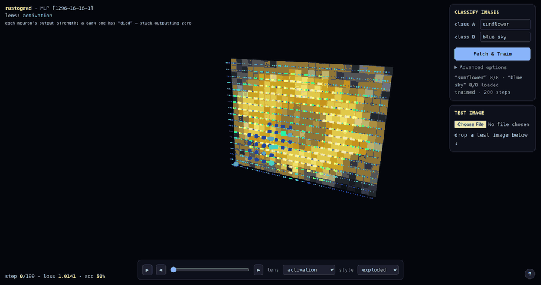

# rustograd · a neural net you can watch learn

This app trains a tiny neural network to tell two kinds of images apart, and draws it as a 3-D cube **as it learns, step by step**.

**Live demo: [aubrika.github.io/rustograd](https://aubrika.github.io/rustograd/)**



## How to use

- Type a search term for **class A** and **class B** (e.g. "sunflower" vs "blue sky").
- Hit **Fetch & Train**. Example images are pulled from Wikimedia Commons and the net trains live.
- Drop any image into **Test image** to see which class it's more like.
- **Advanced options** tune the network. Hover any field for an explanation.

## Watching it learn

Each small cube is a neuron. **←/→** switch the color lens (gradient · weight · activation), **↑/↓** change the layout, drag to orbit, scroll to zoom, and hover a neuron for its numbers. On the gradient lens you'll see the cube "cool down" as the loss falls.

## What to expect

It's a **toy**. It does best with visually distinct classes (color) and will struggle with semantic ones like cat-vs-dog: it only sees a 24×18 thumbnail by default, with no convolutions or pretrained features. Small training sets mean it can overfit, too.

## Learn more

This is a Rust reimplementation of Andrej Karpathy's [micrograd](https://github.com/karpathy/micrograd). His YouTube video ["The spelled-out intro to neural networks and backpropagation: building micrograd"](https://www.youtube.com/watch?v=VMj-3S1tku0) is a great place to start learning how this works. :)

## Under the hood

- **Autograd engine** (`src/engine.rs`): scalar-valued, like micrograd, but arena-based. A `Graph` owns a `Vec` of nodes and every value is a `usize` index into it, so there is no `Rc<RefCell<…>>` and no operator overloading. It has micrograd's full op set: add, mul, pow and ReLU, with neg, sub and div built from those. The arena is append-only, so it is already in topological order and `backward` is a single reverse pass.
- **Neural-net library** (`src/nn.rs`): `Neuron`, `Layer` and `MLP`, mirroring micrograd's `nn.py`.
- **Trainer** (`src/trainer.rs`): a binary classifier with SVM hinge loss and L2 regularization. It trains one step at a time and emits a per-neuron telemetry frame each step. The same code runs natively and in the browser.
- **wasm bindings** (`src/wasm.rs`): the trainer compiled to WebAssembly with `wasm-bindgen`.
- **Viewer** (`viz/index.html`): a single-page [three.js](https://threejs.org/) app. It fetches the images, calls into the wasm once per animation frame, and draws each telemetry frame.

## Build and run

The viewer is static and the compiled wasm is committed in `viz/wasm/`, so opening `viz/index.html` in a browser is enough. It needs a network connection for three.js and the Wikimedia images.

To rebuild the wasm after changing the Rust code:

```bash
rustup target add wasm32-unknown-unknown
cargo install wasm-bindgen-cli --version 0.2.126   # must match the version pinned in Cargo.toml

scripts/build-wasm.sh          # macOS / Linux
pwsh scripts/build-wasm.ps1    # Windows
```

There is also a terminal version of micrograd's moons demo, which prints an ASCII decision boundary:

```bash
cargo run --release --example demo
```

## Tests

```bash
cargo test
```

The engine tests port micrograd's own test cases and add a finite-difference gradient check.

## Repo map

| Path | What |
|---|---|
| `src/engine.rs` | the autograd engine |
| `src/nn.rs` | `Neuron`, `Layer`, `MLP` |
| `src/trainer.rs` | training loop and per-step telemetry, shared by the native and wasm builds |
| `src/wasm.rs` | WebAssembly bindings (wasm32 only) |
| `src/bin/repl.rs` | placeholder REPL that only echoes input (see the roadmap) |
| `examples/demo.rs` | the moons demo in the terminal |
| `examples/record.rs` | trains the moons net natively and dumps its telemetry to `viz/recording.js` |
| `viz/` | the three.js viewer and the built wasm; GitHub Pages serves this folder |
| `tests/engine.rs` | engine tests |
| `scripts/` | wasm build scripts |

[ROADMAP.md](ROADMAP.md) is my learning roadmap: the checklist I worked from while porting micrograd. Its unchecked boxes are things I haven't built, not missing pieces of the app.

## License and credits

[MIT](LICENSE). Built with AI coding assistance (Claude Code). The design decisions are mine, and micrograd is Andrej Karpathy's.
